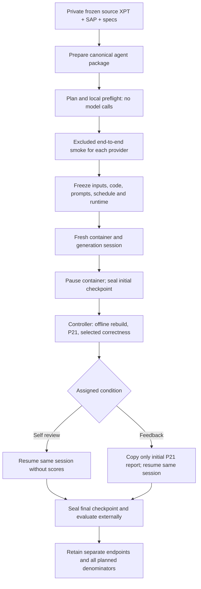

# Main experiment: independent generation and one same-session repair

This is the entry point for collaborator review of the main experiment. The
`experiment/` runner and its protocol documents describe the earlier pilot.
Use `python -m main_experiment` for the revised main study.

**Implementation status:** offline protocol and synthetic scoring tests are
implemented. Real-provider sessions, the Docker image and P21/MedDRA integration
must pass three excluded smoke workflows on the experiment machine before
freezing or starting the main study. A passing CI job is not that qualification.

## Design to review

There are **18 independent workflows**: three exact provider/model IDs × two
conditions × three repetitions. Each workflow has its own initial generation;
there is no shared initial output between conditions. A deterministic shuffled
schedule is saved in the freeze manifest. Each workflow gets one generation
and one repair, with 4 CPUs and 8 GB memory and no agent execution time cap (`phase_seconds: null`). The maximum
is 36 agent phase invocations; total agent runtime and API cost have no fixed
upper bound. An agent phase can make many provider requests. External rebuild
and P21 validation retain their separate timeouts. Agents run until they finish,
fail, or are manually interrupted.

| Condition | Initial prompt | Repair history | Repair feedback |
|---|---|---|---|
| Self review | Identical generation prompt | Same OpenCode session | Own files and logs |
| P21 feedback | Identical generation prompt | Same OpenCode session | Own files/logs and its initial P21 XLSX only |



Conditions are controller-side assignments. The initial prompt, workspace paths
and container environment do not reveal the assigned condition. Condition-specific
instructions appear only after the initial checkpoint. The repair uses explicit
`--session ID`; the controller checks the returned ID and that exported message
IDs preserve and extend the initial history. It never uses `--continue` or forks.
The persistent state volume holds OpenCode history; it is absent from evaluation.

## Code map for comments

| File | Review focus |
|---|---|
| [config.example.json](../main_experiment/config.example.json) | Exact models, budgets, datasets, local paths |
| [core.py](../main_experiment/core.py) | Design guards, input preparation, schedule and fingerprints |
| [prompts](../main_experiment/prompts/) | Identical generation and condition-specific repair instructions |
| [backend.py](../main_experiment/backend.py) | Docker boundaries, timeouts, sessions and raw telemetry |
| [egress.py](../main_experiment/egress.py), [network/](../main_experiment/network/) | Mandatory provider-only gateway, namespace rules and bypass probes |
| [runner.py](../main_experiment/runner.py) | Checkpoints, feedback delivery, failures and reporting |
| [evaluate.py](../main_experiment/evaluate.py) | Offline rebuild, semantic/byte reproduction and P21 isolation |
| [derivation.py](../main_experiment/derivation.py) | Selected source-derived correctness checks |
| [scoring-rules.json](../main_experiment/scoring-rules.json) | Endpoints and qualifications |
| [test_main.py](../main_experiment/test_main.py), [test_scoring.py](../main_experiment/test_scoring.py) | Synthetic correct/corrupted examples |

## Local setup and input preparation

Run commands from the repository root. Keep all actual data, configuration,
credentials, dictionary files, transcripts, reports and results **outside Git**.
The example paths below are placeholders; substitute your private paths.

```sh
python -m venv .venv
. .venv/bin/activate
python -m pip install -r main_experiment/requirements.txt
cp main_experiment/config.example.json main_experiment/config.local.json
cp .env.example .env.local
```

Edit `config.local.json` to set absolute input, Java, P21-cache and dictionary
paths. Set `phase_seconds` to `null` in existing local configurations. Previous
smoke receipts and freeze locks must be regenerated after this protocol change.
Set the three provider keys in `.env.local` using literal `KEY=value` entries. Never commit or paste keys into review comments. The controller passes
only the selected provider's credential into each agent phase.

Build with an explicitly reviewed OpenCode release, then record it in your
experiment notes. The image's resolved content ID and CLI version are frozen;
no automatic upgrade or model substitution occurs.

```sh
docker build --build-arg OPENCODE_VERSION=1.19.0 \
  -t adam-experiment:main -f experiment/Dockerfile .
```

The release above is a candidate pin, **not a claim of qualified provider access**.
Preflight checks CLI capabilities and catalog membership; the excluded smoke
checks actual provider access and event/export compatibility.

```sh
python -m main_experiment prepare-inputs \
  --source /private/study/FinalizedInput/MainExperiment-Input \
  --out /private/study/prepared-inputs --fix-trta-predecessor
```

Preparation creates a new package with 22 authoritative XPT files, SAP.pdf and a
cell-value JSON export of all specification sheets. Dataset-JSON duplicates and
the proposal are not agent inputs. It excludes `.DS_Store`. TS's source encoding
is explicitly Windows-1252. The source workbook remains untouched.

The explicit correction flag changes the known ADVS.TRTA character predecessor
from `ADSL.TRT01AN` to `ADSL.TRT01A` in cells H16/J16/P16 of the exported specs.
Without the flag, preparation fails on this inconsistency. A sibling provenance
JSON records the original workbook hash, before/after cells and package hashes;
it is controller-only. Do not give the contradictory original workbook alongside
the corrected export. Review the exported specs and provenance before freeze.

## Review, qualify, freeze, execute

Planning does not need Docker, credentials or study files:

```sh
python -m main_experiment plan --config main_experiment/config.example.json
python -m unittest discover -s main_experiment -p 'test_*.py' -v
python -m unittest discover -s experiment -p 'test_*.py' -v
```

Local preflight reads input/runtime hashes, verifies all five MedDRA files,
checks credentials are present and inspects the image's OpenCode catalog/help.
It does not invoke a model, upload data, or prove provider account entitlement.

```sh
python -m main_experiment preflight
```

The next commands **incur API charges and send authorized study inputs to the
selected provider**. Each excluded smoke is a fresh generation plus a feedback
repair, including external rebuild/P21/correctness. Run once per provider:

```sh
python -m main_experiment smoke --model openai --out /private/study/smokes --execute
python -m main_experiment smoke --model anthropic --out /private/study/smokes --execute
python -m main_experiment smoke --model google --out /private/study/smokes --execute
python -m main_experiment freeze --smokes /private/study/smokes \
  --out /private/study/main --lock /private/study/main.freeze.json
python -m main_experiment run --out /private/study/main \
  --lock /private/study/main.freeze.json --execute
python -m main_experiment report --out /private/study/main
```

Freeze requires one qualifying receipt per provider matching the current
code/config/input/runtime fingerprint. Qualification requires completed reports,
semantic reproduction and assessable selected correctness checks at both smoke
checkpoints; correctness error counts need not be zero. It is deliberately strict
about unavailable checks. Inspect raw histories, session continuity, feedback
isolation, P21 dictionary recognition and runtime versions as part of local
qualification. Changing code, prompts, config, inputs, image, Java, dictionaries
or P21 rules invalidates the receipts and lock. A failed smoke is retained;
use a separately named smoke output directory for a deliberately adjudicated
replacement and document why. Never silently replace an attempt.

Main output is bound to the full freeze lock. The controller skips only completed
and sealed workflows, or a recorded terminal `feedback_unavailable` workflow.
A failed, interrupted or uncertain agent invocation stops scheduling. There are
no automatic retries, extra repairs, shortened inference budgets or model swaps.
A crash retains `.running`; inspect the private evidence and stopped container
before removing this controller guard. Do not delete attempt folders to obtain
a better result. Administrative decisions belong in the private study log.

If initial P21 feedback is unavailable, the feedback repair is not invoked; this
workflow stays in the planned denominator and scheduling proceeds. In the self
review condition, conformance failure does not prevent the allotted self review.

## Evidence and metrics

Each workflow directory contains controller `state.json`, a stopped container
identity, the live workspace, and `initial/` and `final/` checkpoints. Checkpoints
include the rendered prompt, raw JSONL events, exported session history, agent
execution metadata, workspace hashes, a sealed copy of outputs, evaluation JSON,
P21 report/log and an independent clean rebuild. The container is paused during
checkpointing and external evaluation. Checkpoint manifests detect later changes;
they are not a cryptographic signature or an OS write-protection mechanism.
Stopped containers and state volumes are retained for audit; remove them manually
only after retention requirements are met. They may contain sensitive data.

* **Conformance:** completed P21 dataset-rule pairs, severity details and record
  counts. A report with findings is a usable report; missing/invalid reports are
  unavailable, never zero findings. P21 client 1.0.9, FDA engine 2508.1, ADaMIG 1.3,
  Model 2.1 and CT 2026-03-27 are the planned qualification targets. CLI and rules
  are hashed; confirm all reported versions during smoke.
* **Correctness:** selected source checks are separate from conformance. NPI uses
  randomized DM arms and a unique distinct complete SV VISITNUM=3 date, with no DM
  fallback. Baseline includes WDAY <=1; ties use distance, date, QSSEQ. TTE coverage
  uses POP01 source exposure evidence, including placebo dose >=0. Exact event
  predecessors and follow-up bounds are checked. Missing/extra/duplicate coverage
  components remain explicit. These checks do not certify every ADaM derivation.
* **Qualifications:** dermatologic and treatment-emergent flags remain conditional
  on generated ADAE. TTE duration +1 and RFENDTC censoring are experiment conventions.
  English MedDRA 8.0 is required, with hashed PT/SOC/LLT/HLT/HLGT files; masked HLT/
  HLGT/source provenance is not independently confirmed. No missing-dictionary
  allowance is passed to the report parser.
* **Reproduction:** rebuild runs offline with only programs and read-only source
  inputs. Semantic equality checks exact ordered values, labels, types, widths
  and canonical Define XML, ignoring only root ODM CreationDateTime. It is
  conservative, not a general clinical equivalence engine. Byte SHA256 equality
  is reported separately. Neither endpoint uses numeric rounding to hide changes.
* **Execution:** raw step-level input/output/reasoning/cache token fields, costs,
  finish reasons and tool events are retained. Re-emitted step IDs are deduplicated;
  unknown telemetry is null. `agent.json` seconds measure active phase wall time;
  workflow timestamps include controller time. Provider billing may differ.

`results.json` retains all 18 scheduled workflows and both checkpoints, including
unavailable endpoints. `summary.md` shows completion status. Within-workflow
initial-to-final reductions are reported only for usable reports. Condition
comparisons must treat initial generations as independent; do not reuse the
pilot's paired-branch analysis or combine correctness and conformance into a
single score. Group-level statistical analysis is left to the prespecified
analysis plan; the controller exports the underlying endpoints.

## Isolation limits and collaborator acceptance

Agent containers mount only their live workspace, read-only prepared inputs and
their own persistent state. Controller code, hidden scores, references, P21 cache
and the repository are absent. Rebuild containers have no network. Agent containers
use a provider-only CONNECT gateway plus IPv4/IPv6 OUTPUT rules in the agent's
own network namespace. Shell commands cannot bypass these rules by clearing proxy
variables, using a numeric IP, alternate DNS or UDP/QUIC. Only gateway TCP 8080
and TCP localhost for the local OpenCode server are allowed. Browsing tools,
default plugins, model-catalog refreshes, auto updates and LSP downloads are
also disabled. Package installation during a run is unavailable; install all
required dependencies in the reviewed image before qualification.

The gateway permits HTTPS 443 only for the assigned provider: `api.openai.com`,
`api.anthropic.com` or `generativelanguage.googleapis.com`. It checks exact host
names, matching TLS SNI and public upstream DNS addresses. There are no wildcard
domains, OAuth/login hosts, search engines, GitHub or package registries on the
allowlist. Redirects to other hosts fail. The gateway has no study mounts or keys.
It retains connection decisions without recording TLS payloads, headers or keys.

A short-lived NET_ADMIN helper installs rules **only in the agent container's
network namespace**; the agent has no capabilities and cannot change those rules.
No host networking, Docker socket or host firewall modification is used. Failure
to install IPv4/IPv6 rules or pass bypass probes stops the workflow before any
model invocation. The same policy is mandatory for both conditions and all
repetitions. Gateway, helper code and policy are covered by the freeze fingerprint;
rebuild the image and repeat qualification after this change. Old smoke receipts
and locks cannot be reused.

Each workflow records `egress-policy.json`, `egress-rules.json`,
`egress-probes.json` and `egress-gateway.jsonl` outside the agent workspace.
A separate no-key Docker integration check tests denied direct HTTP/HTTPS and DNS,
denied non-provider CONNECT and mismatched SNI, plus successful provider TLS
handshakes. It sends no HTTP API request, credentials, prompts or study inputs:

```sh
python -m main_experiment.network_check --image adam-experiment:main \
  --out /private/study/network-check
```

GitHub CI runs this check with a minimal Python/iptables image and retains its
synthetic evidence. Local provider smoke tests must still validate the actual
pinned OpenCode image, proxy compatibility and API access. There is no fallback
to unrestricted networking if the model runtime needs an unapproved endpoint.

This is an outbound host restriction, not TLS interception: allowed API traffic
stays encrypted, so the gateway does not inspect model prompts, API paths or
provider-native search/grounding arguments. The prescribed OpenCode run has no
browsing tools, and the prompt prohibits requesting provider-native search.
Do not claim this eliminates model training-data memorization, controls the
provider's internal infrastructure or protects against a compromised Docker host.

Before approving a main launch, collaborators should comment on:

- Whether the independent 18-workflow design, budgets and statistical comparison
  match the final proposal.
- The exact model IDs, prompts, canonical input export and TRTA correction.
- Correctness scope, coverage denominators, failure policy and MedDRA qualifications.
- Local smoke evidence for all providers, CLI session exports, P21 versions,
  dictionary use, feedback isolation and clean offline reconstruction.
- Data-governance authorization for provider uploads and evidence retention.

Use PR review comments on the files in the code map. CI uses synthetic data only;
GitHub Actions never receives provider keys or clinical inputs and never runs the
main experiment.

Runtime references: [OpenCode CLI](https://opencode.ai/docs/cli/) documents explicit
session continuation and export; [P21 Community CLI](https://help.pinnacle21.certara.net/en/articles/9737181-validate-with-p21-community-cli)
documents ADaM validation and the MedDRA version argument. Those upstream pages
are references; the local smoke qualifies the pinned installation.

Network references: [OpenCode proxy support](https://opencode.ai/docs/network/) and
[Docker container networking/capabilities](https://docs.docker.com/engine/containers/run/).
